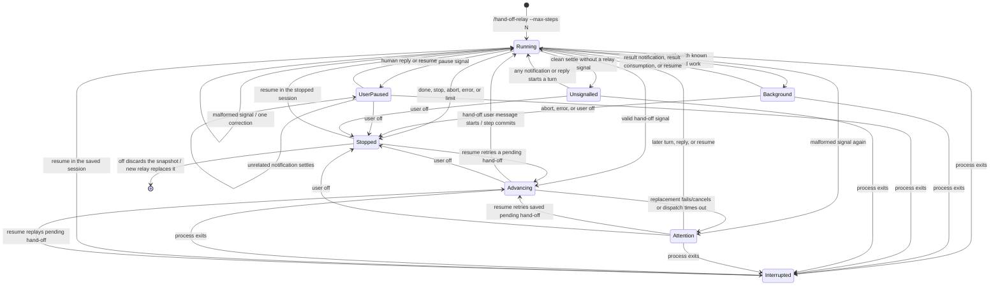

# Relay lifecycle

This document describes `/hand-off-relay` state transitions and recovery. It is
an implementation guide; the README contains the shorter user-facing version.

## State diagram

`off` from any live state disables autonomy but preserves a stopped snapshot.
`off` on that snapshot discards it. Starting a new relay replaces the snapshot;
starting one while another relay waits on a different session replaces that stale relay, as before.

## States and available actions

| State | Meaning | User action | Agent behavior |
| --- | --- | --- | --- |
| **Running** | The current session owns the relay and may be working. Known background tasks can coexist with this state. | Reply to steer, stage the next model, inspect `status`, or use `off`. | Work normally. End with one hand-off, done, pause, or stop signal only when that signal describes the actual boundary. |
| **Background** | The main agent is idle while an integration reports outstanding background work or a completed result that has not reached the main agent. | Wait for the result, inspect `status`, or use `off`. If result delivery is lost, `resume` releases the completed-result guard; it does not skip running tasks. | Do not hand off, finish, pause, or stop merely because results are pending. Continue after the result notification or result-consumption path. |
| **Unsignalled** | The main agent settled without a relay signal and no integration knows why. This is the extension-agnostic background-work fallback. | Send a reply, wait for any notification, use `resume` to request a signal now, or use `off`. | Continue on the next turn. If no background result is coming, wait for the user rather than repeatedly emitting tags. |
| **UserPaused** | The agent explicitly asked for a human answer. | Reply in the same session or use `resume`; `off` stops recoverably. | Unrelated notifications may run, but cannot advance or finish the relay. Only human input or `resume` clears this wait. |
| **Attention** | A repeated malformed signal or failed advance needs intervention. State and any pending hand-off are preserved. | Reply with guidance or use `resume`. Resume retries replacement, or replays an undelivered prompt in an existing replacement session. `off` stops recoverably. | Do not autonomously repeat malformed tags. A later notification-driven turn can retry an agent-side failure; an advance failure requires `resume`. |
| **Advancing** | A valid hand-off is pending and the internal command is replacing the session, or the replacement is waiting for its prompt to start. | Inspect `status`; `off` cancels pending delivery and preserves the prompt. Model staging is closed for this hop. | The next agent receives the saved prompt and relay protocol. Its exact user `message_start` commits the step and clears the delivery marker. |
| **Interrupted** | The process exited in any nonterminal state. The persisted record remains. | Open the named session if necessary and use `resume`; `off` discards the record. | On resume, inspect unfinished background work rather than assuming its result. Process-bound task tracking is not restored. |
| **Stopped / off** | Done, explicit stop, abort, error, limit, or user cancellation disabled autonomy. The snapshot remains but is not active or process-owned. | Open the last session and `resume` to reconsider; add `--max-steps` or `--max-cost` after the corresponding limit stop. `off` discards the snapshot; starting a new relay replaces it. | A model-visible state message deactivates the old protocol. Further tags have no effect unless this relay is resumed or another is explicitly armed. |

`status` reports the state, its reason or outstanding tasks when available, and
the next useful action. `resume` is intentionally broader than crash recovery:
it also resumes an idle, unfinished, or stopped relay in the current session.
A stopped snapshot never blocks a new relay and is never mistaken for an active
relay owned by another process.

## Model decisions and user remedies

| Model decision | Automatic result | User remedy |
| --- | --- | --- |
| Hand off to another agent | `Advancing` starts the next session. | `off` cancels and preserves the pending prompt; `resume` retries it. |
| Declare `done` or `stop` | `Stopped` disables autonomy. | `resume` in the stopped session reactivates the protocol and asks the agent to reconsider; `off` discards. |
| Ask the user a question with `pause` | `UserPaused` ignores unrelated notification turns. | Reply interactively or `resume`; `off` stops recoverably. |
| Finish without a signal | `Unsignalled` stays armed without buying another turn. | Send guidance, wait for a notification, `resume`, or `off`. |
| Emit malformed signals | One correction, then `Attention`. | Reply with guidance or `resume`; `off` stops recoverably. |
| Delegate background work | Known outstanding results hold `Background`; unknown systems use `Unsignalled`. | Inspect `status`, wait, `resume` after a lost result, or `off`. |
| Reach a step or cost limit | `Stopped` prevents more autonomous spend. | Raise the corresponding limit with `resume --max-steps N` or `resume --max-cost USD`; `off` discards. |

## Transition invariants

1. **No known work is abandoned.** A hand-off, done, pause, or stop signal does
   not advance while an adapter reports outstanding tasks or a completion
   notification. Provider errors and aborts remain terminal.
2. **No-signal is not failure.** A clean settle without a tag becomes
   `Unsignalled`; it never deletes the relay. Any later turn retries the
   boundary, regardless of which extension or user started it.
3. **Human pauses require human intent.** Notification-driven turns and
   extension/RPC submissions do not clear `UserPaused` or reset the correction
   budget. Interactive human input and `resume` do.
4. **Protocol failure is bounded but recoverable.** One malformed signal gets a
   correction request. A second becomes `Attention`, not a terminal stop.
5. **Pending hand-offs survive replacement failure.** Session-replacement
   cancellation or exceptions, and advance-dispatch watchdog timeouts, preserve
   the prompt and reset its transient `started` marker. A replacement session
   keeps an undelivered-prompt marker until that exact user message starts;
   `input` is only an early validation hook, not proof of delivery. The
   replacement is not committed to `sessionIds` before then. A crash, swallowed
   send error, or rejected send can therefore resume in that session or replay
   from the previous session without incrementing the step—even when the blank
   replacement was never written to disk. A delivery watchdog turns an
   unacknowledged prompt into `Attention`, and duplicate advance commands are
   no-ops. A process-local single-flight claim also rejects repeated `resume`
   while an earlier send may still be in pi's non-cancellable preflight. Since
   a timeout cannot prove that send died, a stuck preflight must be cleared by
   restarting pi before `resume`; this avoids duplicate agent work. `off`
   during replacement cannot resurrect the relay or overwrite a different relay.
6. **Terminal state reaches both audiences.** Stop and `off` notify the user and
   append a model-visible state message, preventing stale protocol instructions
   from encouraging more tags.
7. **Model decisions have user recovery.** Done, stop, errors, limits, and user
   cancellation preserve a stopped snapshot rather than deleting the only
   recovery state. `resume` supersedes the deactivation message in the original
   session. Step-limit resumes require `--max-steps` above the current step;
   cost-limit resumes require `--max-cost` high enough to clear the 95%
   no-new-session guard. Cancelling a
   pending advance preserves its prompt. If the replacement session exists but
   its first prompt fails or the process exits before the message starts,
   `resume` delivers that prompt there or replays from the previous session
   instead of skipping a step. Existing cost caps are also checked before any
   resume, preventing an immediate billed request followed by another abort.
   Every pending-hop resume, not only a cost-limit stop, must also clear the
   95% new-session guard before delivery or replacement can continue.
8. **Only plain data crosses sessions.** Background task records contain IDs and
   display metadata, never session-bound objects. They are discarded when a
   stopped or interrupted relay resumes.

## Background-work integrations

The generic path requires no integration: `Unsignalled` remains armed and any
later turn retries the relay. This supports notification systems unknown to
pi-hand-off, but cannot prove that work is still outstanding. Agents therefore
must not emit explicit terminal signals while merely waiting.

An optional `pi-subagents` adapter listens to its documented shared-event-bus
lifecycle (`created`, `started`, `completed`, and `failed`). It adds precise
outstanding-task status and suppresses all clean terminal signals until results
arrive. Foreground results are already inline and need no extra guard. RPC,
scheduler, and direct-mention spawns can emit `started` without `created`, so
the adapter uses the documented manager registry's `blocking` field to tell
detached work from inline foreground calls; `isBackground` alone is not enough.
For a background result, the guard clears when its `subagent-notification` message
starts, when `get_subagent_result` returns that result, or when the result is
consumed through the subagent RPC. An unrelated turn cannot clear it; explicit
`resume` is the recovery path if none of those signals arrives. Event
subscriptions are removed on session shutdown. Other integrations use the
generic unsignalled-idle fallback without changing the core decision logic.

The adapter observes events after the relay is armed; it does not reconstruct a
list of background tasks that were already running. The generic idle fallback
and the relay protocol still apply in that case.
